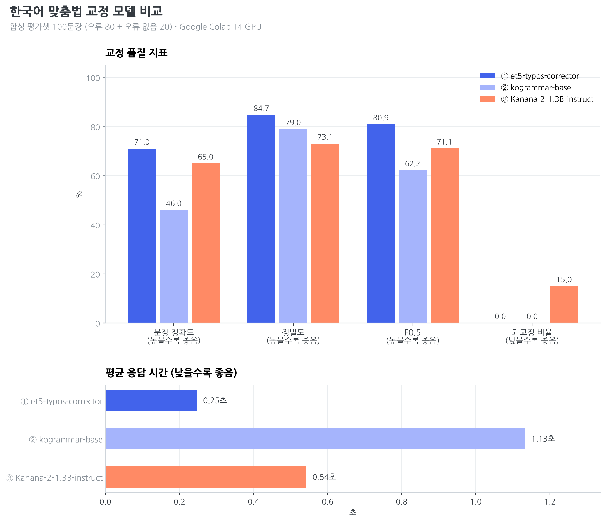

# 일기 교정 서비스 실험 결과 (eval)

초등학생 일기 교정 서비스(북이온엔온)에서 **어떤 모델과 검색 방식을 쓸지** 정하기 위한 실험 결과를 모았다.
모든 실험은 아동 개인정보 보호를 위해 로컬 모델만 사용했고, 평가 데이터는 직접 만든 합성 데이터다 (실제 아동의 글 없음).

| 실험 | 정한 것 | 결과 |
|---|---|---|
| [1. 맞춤법 교정 모델 비교](korean-spelling-model-eval/README.md) | 문장을 고치는 모델 | **et5-typos-corrector** 선택 |
| 2. RAG 검색 방식 비교 | 근거 규정을 찾는 방식 | 정리 중 |

---

## 1. 맞춤법 교정 모델 비교

로컬 경량 모델 3종(교정 전용 2종 + 범용 sLLM 1종)을 합성 평가셋 100문장으로 비교했다.

> **결론: ① j5ng/et5-typos-corrector 를 사용한다.** 정밀도·F0.5·과교정 모두 가장 좋고 응답도 가장 빠르다.

| 모델 | 문장 정확도 | 정밀도 | F0.5 (주 지표) | 과교정 비율 | 평균 응답 |
|---|---|---|---|---|---|
| ① et5-typos-corrector | **71.0%** | **84.7%** | **80.9%** | **0.0%** | **0.25초** |
| ② kogrammar-base | 46.0% | 79.0% | 62.2% | **0.0%** | 1.13초 |
| ③ Kanana-2-1.3B-instruct | 65.0% | 73.1% | 71.1% | 15.0% | 0.54초 |

범용 sLLM(③)은 맞춤법만 고치지 않고 문장을 다시 쓰는 경우가 많아(과교정 15%) 교정에는 쓰지 않고, 근거 규정을 읽고 아이 눈높이로 설명하는 역할로 쓰기로 했다.

[자세히 보기 →](korean-spelling-model-eval/README.md)

---

## 2. RAG 검색 방식 비교

> 정리 중이다. 정리되면 `rag-eval/` 폴더에 올리고 이 부분을 채운다.
