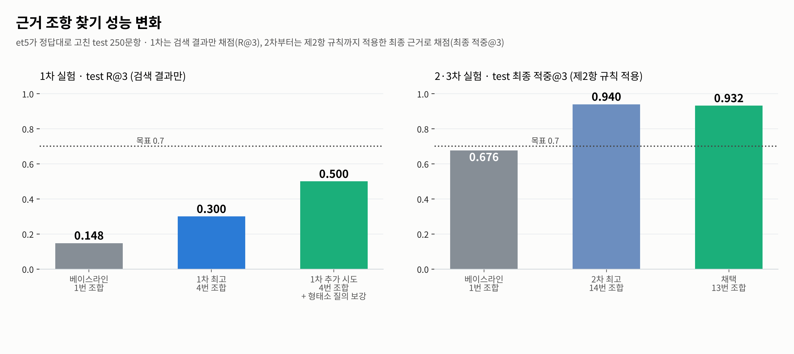
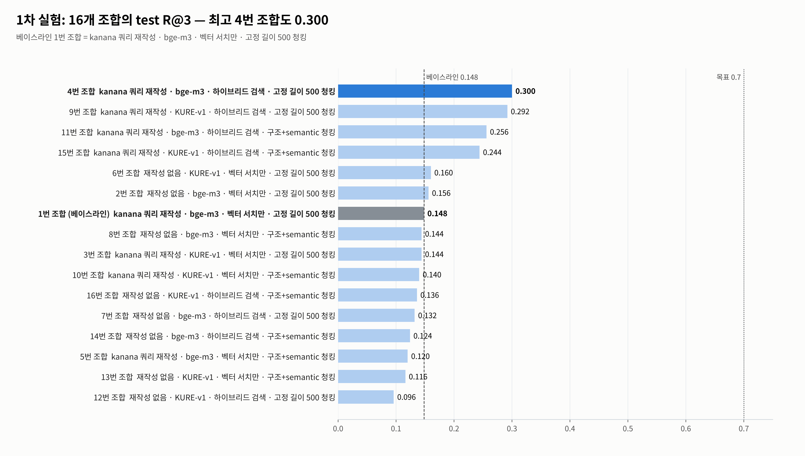
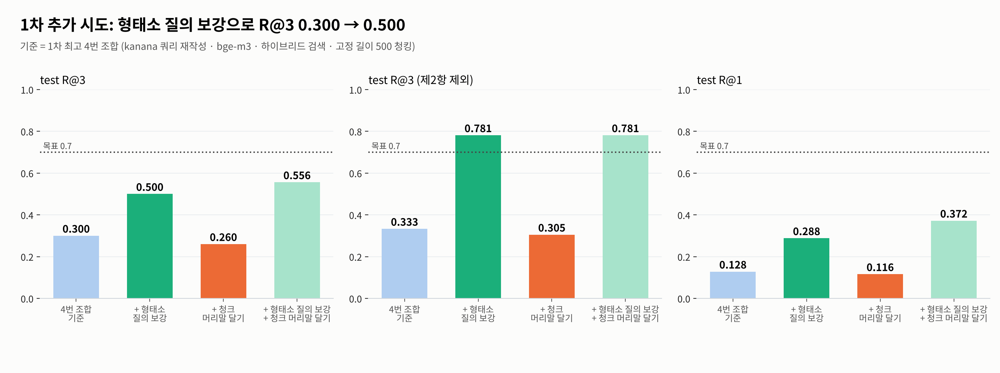
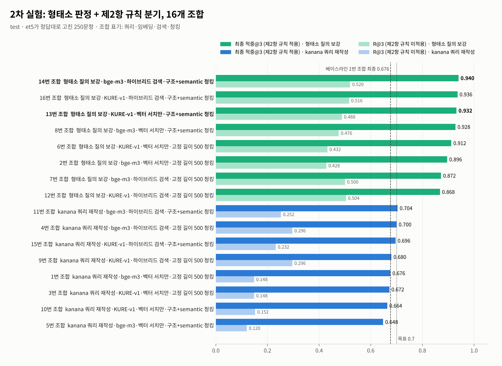
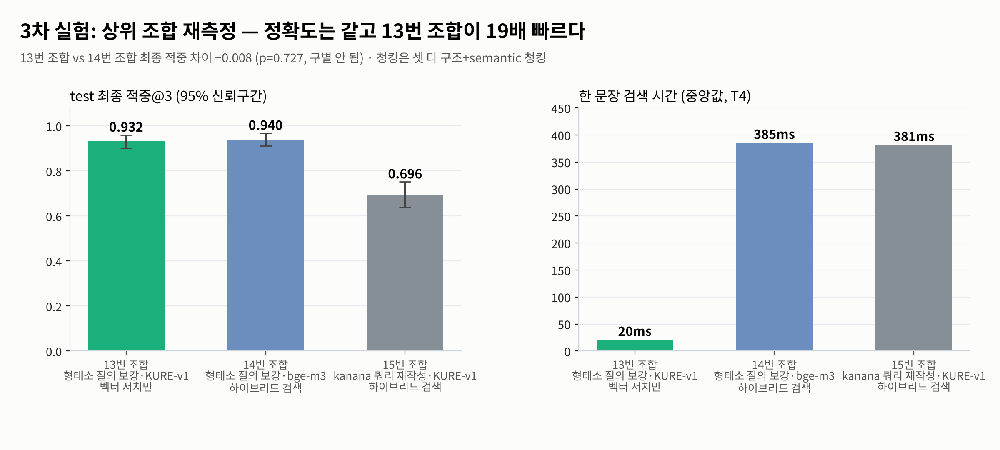

[← 전체 실험 요약으로](../README.md)

# 맞춤법 근거 조항 RAG 검색 방식 비교

et5가 고친 부분마다 **근거가 되는 한글 맞춤법 조항**을 찾아 주는 RAG 검색 방식을 세 차례(1차 → 2차 → 3차)에 걸쳐 비교한 실험이다.

> **결론: 13번 조합 = 형태소 분석기로 다른 부분 추출 후 질의 보강 · KURE-v1 · 벡터 서치만 · 구조+semantic 청킹 · 띄어쓰기 수정이면 제2항을 자동으로 근거에 추가**한 조합을 쓴다.
> test 최종 적중@3 **0.932**로 최고 조합(14번 조합, 0.940)과 통계적으로 구별되지 않으면서(p=0.727), 한 문장 검색은 **20ms**로 14번 조합(385ms)보다 약 19배 빠르다.



---

## 1. 평가 데이터

### 평가셋
| 항목 | 내용 |
|---|---|
| 출처 | AI허브 맞춤법 오류 데이터 (일반인이 쓴 문장, 아동 글 아님) |
| 라벨링 | 1,000문항을 무작위로 뽑아 문항마다 **근거가 되는 한글 맞춤법 조항**을 직접 달았다 (예: `맞춤법-42`, 최대 2개) |
| 평가 문항 | 그중 **500문항**을 층화 무작위 추출 (seed 42) → **dev 146 / test 354**. 1·2·3차 모두 같은 500문항 |
| 채점 대상 | et5가 **정답대로 고친 문항**만 채점한다 (et5 성능과 RAG 성능을 분리하기 위해) |

et5 교정 결과에 따른 문항 수:

| | 일치 (정답대로 고침) | 다르게 고침 | 고치지 못함 |
|---|---|---|---|
| test | **250** | 88 | 16 |
| dev | **114** | 29 | 3 |

- 주 지표는 **test 일치 250문항** 기준이다. 이 중 **145문항(58%)은 정답에 제2항(띄어쓰기 대원칙)** 이 들어 있다.

### 검색 대상 문서
- 국립국어원 「한글 맞춤법」 본문 제1~57항 (국립국어원 누리집에서 내려받음)
- et5가 문장 부호를 고치지 않으므로 부록(문장 부호)은 뺀다.

## 2. 평가 방법

```
원문 ─► et5 교정 ─► 원문 vs 교정문 diff (어절 단위, 앞뒤 1어절 포함)
                            │
                            ▼
                     질의 만들기 
                            │
                            ▼
      검색 (벡터 서치만 / 벡터+BM25 → RRF → bge-reranker-v2-m3)  ◄── 한글 맞춤법 규정 청크
                            │
                            ▼
           근거 조항 최대 3개 vs 정답 조항 채점
```

---

## 3. 1차 실험: 16개 조합 → 추가 시도

### 3-1. 베이스라인과 16개 조합

**베이스라인 1번 조합** = kanana 2.1B 쿼리 재작성 · bge-m3 임베딩 · 벡터 서치만 · 고정 길이 500으로 청킹

여기서 4개 축(쿼리 · 임베딩 · 검색 · 청킹)마다 두 가지 방식을 두고, 모든 경우를 조합해 2⁴ = 16개 조합을 비교했다.

| 축 | 베이스라인 방식 | 비교한 방식 |
|---|---|---|
| 쿼리 | kanana 2.1B 쿼리 재작성 | 재작성 없음 (diff 그대로) |
| 임베딩 | bge-m3 | KURE-v1 |
| 검색 | 벡터 서치만 | 하이브리드 검색: 벡터 50 + BM25 50 → RRF 20 → bge-reranker-v2-m3 리랭킹 |
| 청킹 | 고정 길이 500으로 청킹 | 구조+semantic 청킹 (조항 경계 + 유사도 하위 10% 지점, 200~800자) |

16개 조합 전체를 test R@3 순으로 줄 세우면 다음과 같다.
“test R@3 0.300"은 “test 250문항 중 30%에서 상위 3개 검색 결과에 정답 조항이 있었다"는 뜻이다.

| 순위 | 조합 | 쿼리 | 임베딩 | 검색 | 청킹 | test R@3 |
|---|---|---|---|---|---|---|
| 1 | **4번 조합** | kanana 쿼리 재작성 | bge-m3 | 하이브리드 검색 | 고정 길이 500 청킹 | **0.300** |
| 2 | 9번 조합 | kanana 쿼리 재작성 | KURE-v1 | 하이브리드 검색 | 고정 길이 500 청킹 | 0.292 |
| 3 | 11번 조합 | kanana 쿼리 재작성 | bge-m3 | 하이브리드 검색 | 구조+semantic 청킹 | 0.256 |
| 4 | 15번 조합 | kanana 쿼리 재작성 | KURE-v1 | 하이브리드 검색 | 구조+semantic 청킹 | 0.244 |
| 5 | 6번 조합 | 재작성 없음 | KURE-v1 | 벡터 서치만 | 고정 길이 500 청킹 | 0.160 |
| 6 | 2번 조합 | 재작성 없음 | bge-m3 | 벡터 서치만 | 고정 길이 500 청킹 | 0.156 |
| 7 | 1번 조합 (베이스라인) | kanana 쿼리 재작성 | bge-m3 | 벡터 서치만 | 고정 길이 500 청킹 | 0.148 |
| 8 | 3번 조합 | kanana 쿼리 재작성 | KURE-v1 | 벡터 서치만 | 고정 길이 500 청킹 | 0.144 |
| 9 | 8번 조합 | 재작성 없음 | bge-m3 | 벡터 서치만 | 구조+semantic 청킹 | 0.144 |
| 10 | 10번 조합 | kanana 쿼리 재작성 | KURE-v1 | 벡터 서치만 | 구조+semantic 청킹 | 0.140 |
| 11 | 16번 조합 | 재작성 없음 | KURE-v1 | 하이브리드 검색 | 구조+semantic 청킹 | 0.136 |
| 12 | 7번 조합 | 재작성 없음 | bge-m3 | 하이브리드 검색 | 고정 길이 500 청킹 | 0.132 |
| 13 | 14번 조합 | 재작성 없음 | bge-m3 | 하이브리드 검색 | 구조+semantic 청킹 | 0.124 |
| 14 | 5번 조합 | kanana 쿼리 재작성 | bge-m3 | 벡터 서치만 | 구조+semantic 청킹 | 0.120 |
| 15 | 13번 조합 | 재작성 없음 | KURE-v1 | 벡터 서치만 | 구조+semantic 청킹 | 0.116 |
| 16 | 12번 조합 | 재작성 없음 | KURE-v1 | 하이브리드 검색 | 고정 길이 500 청킹 | 0.096 |



**결과**
- 최고 성능은 **4번 조합 (kanana 쿼리 재작성 · bge-m3 · 하이브리드 검색 · 고정 길이 500 청킹) R@3 0.300**이었다. 
- 최고 성능의 조합은 베이스라인(0.148)의 2배지만 **목표 0.7에 크게 못 미쳤다.** 쓸 수 없다.
- 실패 원인을 보니 **제2항**(띄어쓰기 대원칙)을 잘 검색하지 못해서였다. 제2항은 총칙의 한 문장짜리 대원칙이라 검색으로는 거의 찾지 못했다.

조합만 바꿔서는 목표에 닿을 수 없다고 보고, **질의를 만드는 방식 자체를 바꾸는 추가 시도**를 했다.

### 3-2. 추가 시도: 형태소 질의 보강 · 청크 머리말 달기

1차 최고 조합인 **4번 조합**(kanana 쿼리 재작성 · bge-m3 · 하이브리드 검색 · 고정 길이 500 청킹)을 기준으로, 두 가지 방법을 더해 비교했다.

| 방법 | 내용 |
|---|---|
| **형태소 질의 보강** | diff 조각을 형태소 분석(Kiwi)해 문법 범주를 질의 앞에 붙인다. 규칙 기반이라 없는 규정을 지어내지 않는다 |
| **청크 머리말 달기** | 모든 청크 앞에 그 조항의 첫 문장(규정 문장)을 붙인다 |

```
할수있다 → 할 수 있다
→ "의존 명사 '수' 띄어쓰기; 단어 '있' 앞 띄어쓰기 | 우리는 할수있다 → 우리는 할 수 있다"
```



| 실험 (test) | R@3 | R@3 (제2항 제외) | R@1 |
|---|---|---|---|
| 4번 조합 기준 | 0.300 | 0.333 | 0.128 |
| **4번 조합 + 형태소 질의 보강** | **0.500** | **0.781** | **0.288** |
| 4번 조합 + 청크 머리말 달기 | 0.260 | 0.305 | 0.116 |
| 4번 조합 + 형태소 질의 보강 + 청크 머리말 달기 | 0.556 | 0.781 | 0.372 |

**결과**
- **형태소 질의 보강**으로 R@3이 0.300 → 0.500으로 올랐다. 제2항이 정답인 경우를 빼고 보니, 0.333 → 0.781로 **목표 0.7을 넘었다.**
- kanana 쿼리 재작성 대신 형태소 분석 규칙으로 질의를 만들기 때문에 LLM 호출도 한 번 줄일 수 있다.
- 청크 머리말 달기는 단독으로 쓰면 오히려 낮아졌고(0.300 → 0.260), 질의 보강과 함께 써도 제2항 제외 기준은 그대로(0.781)여서 쓰지 않기로 했다.
- 남은 문제는 **제2항**이다. 검색으로는 여전히 찾지 못하므로, 2차에서 규칙으로 따로 처리하기로 했다.

---

## 4. 2차 실험: 형태소 판정 + 제2항(띄어쓰기 대원칙, 구체 하위 항은 없는 경우)만 규칙으로 분기(검색기에 넣지 않음), 16개 조합

### 바꾼 점
1. **쿼리 축을 "kanana 쿼리 재작성 vs 형태소 질의 보강"으로 바꿨다.** 
2. **제2항은 검색 대신 규칙으로 붙인다.** 형태소 분석으로 수정 유형을 판정하고, 유형에 따라 최종 근거를 정한다.

### 2차부터 쓰는 지표: 최종 적중@3

1차에서는 **검색 결과만** 채점했다(R@3, R@1).
2차부터는 검색 결과에 **제2항 규칙**(띄어쓰기 수정이면 제2항을 자동으로 근거에 추가)을 더한 **최종 근거**를 채점한다. 이 점수가 **최종 적중@3**이다.

| 지표 | 무엇을 채점하나 | 제2항 규칙 | 
|---|---|---|
| R@1 | 검색 1등 청크의 조항 | 적용 안 함 | 
| R@3 | 검색 상위 3개 청크의 조항 | 적용 안 함 | 
| **최종 적중@3** | 제2항 규칙까지 적용한 **최종 근거**(최대 3개)의 조항 | 적용 |

최종 근거는 판정 유형에 따라 이렇게 정해진다.

| 판정 유형 | 최종 근거 (최대 3개) |
|---|---|
| ① 글자만 고침 | 검색 상위 3개 → **R@3과 같다** |
| ② 띄어쓰기 + 구체 규칙 | 제2항 + 검색 상위 2개 |
| ③ 띄어쓰기 + 글자도 고침 | 제2항 + 검색 상위 2개 |
| ④ 일반 띄어쓰기만 | 제2항만 |

**예시**: `학교에가서 → 학교에 가서` (정답 = 제2항)

| | 근거 목록 | 채점 |
|---|---|---|
| R@3 (RAG 검색 결과만) | 제42항, 제47항, 제50항 | ✗ 제2항이 없어 틀림 |
| 최종 적중@3 | 제2항 (④ 일반 띄어쓰기라 규칙으로 추가) | ✓ 맞음 |

- 정답의 58%가 제2항이라, 제2항을 규칙으로 붙이는 것만으로 최종 적중@3이 R@3보다 크게 높아진다.
- 검색 자체가 구체 조항(의존 명사, 준말 등)을 얼마나 잘 찾는지는 2차 결과표의 R@3 / R@1 칸으로 따로 확인한다.


### 결과



16개 조합 전체를 최종 적중@3 순으로 줄 세우면 다음과 같다.

| 순위 | 조합 | 쿼리 | 임베딩 | 검색 | 청킹 | 최종 적중@3 | RAG만 R@3 | RAG만 R@1 |
|---|---|---|---|---|---|---|---|---|
| 1 | **14번 조합** | 형태소 질의 보강 | bge-m3 | 하이브리드 검색 | 구조+semantic 청킹 | **0.940** | 0.520 | 0.408 |
| 2 | 16번 조합 | 형태소 질의 보강 | KURE-v1 | 하이브리드 검색 | 구조+semantic 청킹 | 0.936 | 0.516 | 0.408 |
| 3 | **13번 조합** | 형태소 질의 보강 | KURE-v1 | 벡터 서치만 | 구조+semantic 청킹 | **0.932** | 0.488 | 0.408 |
| 4 | 8번 조합 | 형태소 질의 보강 | bge-m3 | 벡터 서치만 | 구조+semantic 청킹 | 0.928 | 0.476 | 0.388 |
| 5 | 6번 조합 | 형태소 질의 보강 | KURE-v1 | 벡터 서치만 | 고정 길이 500 청킹 | 0.912 | 0.432 | 0.376 |
| 6 | 2번 조합 | 형태소 질의 보강 | bge-m3 | 벡터 서치만 | 고정 길이 500 청킹 | 0.896 | 0.428 | 0.364 |
| 7 | 7번 조합 | 형태소 질의 보강 | bge-m3 | 하이브리드 검색 | 고정 길이 500 청킹 | 0.872 | 0.500 | 0.288 |
| 8 | 12번 조합 | 형태소 질의 보강 | KURE-v1 | 하이브리드 검색 | 고정 길이 500 청킹 | 0.868 | 0.504 | 0.292 |
| 9 | 11번 조합 | kanana 쿼리 재작성 | bge-m3 | 하이브리드 검색 | 구조+semantic 청킹 | 0.704 | 0.252 | 0.088 |
| 10 | 4번 조합 | kanana 쿼리 재작성 | bge-m3 | 하이브리드 검색 | 고정 길이 500 청킹 | 0.700 | 0.296 | 0.124 |
| 11 | 15번 조합 | kanana 쿼리 재작성 | KURE-v1 | 하이브리드 검색 | 구조+semantic 청킹 | 0.696 | 0.232 | 0.080 |
| 12 | 9번 조합 | kanana 쿼리 재작성 | KURE-v1 | 하이브리드 검색 | 고정 길이 500 청킹 | 0.680 | 0.296 | 0.112 |
| 13 | 1번 조합 (베이스라인) | kanana 쿼리 재작성 | bge-m3 | 벡터 서치만 | 고정 길이 500 청킹 | 0.676 | 0.148 | 0.072 |
| 14 | 3번 조합 | kanana 쿼리 재작성 | KURE-v1 | 벡터 서치만 | 고정 길이 500 청킹 | 0.672 | 0.148 | 0.052 |
| 15 | 10번 조합 | kanana 쿼리 재작성 | KURE-v1 | 벡터 서치만 | 구조+semantic 청킹 | 0.664 | 0.152 | 0.080 |
| 16 | 5번 조합 | kanana 쿼리 재작성 | bge-m3 | 벡터 서치만 | 구조+semantic 청킹 | 0.648 | 0.120 | 0.064 |

축별 평균 효과 (최종 적중@3): **형태소 질의 보강 +0.231**, 구조+semantic 청킹 +0.022, 하이브리드 검색 +0.008, KURE −0.000

- 최고 조합 **14번 조합이 최종 적중@3 0.940**으로 베이스라인(0.676)보다 0.264 높고 목표 0.7을 넘었다.
- 형태소 질의 보강이 가장 큰 효과를 냈다. 질의 보강을 쓴 8개 조합은 모두 0.86 이상이고, kanana 쿼리 재작성 8개는 모두 0.71 이하다.
- 하이브리드 검색 + 리랭킹은 성능 개선 폭 대비 시간에서 비효율적이었다. 크로스인코더를 사용해야하는 구조상, 질문-벡터 쌍을 일일이 만들어 계산해야 하기 때문이다.
- 그래서 정확도가 비슷하다면 빠른 조합을 쓸 수 있는지 3차에서 확인한다.

---

## 5. 3차 실험: 상위 조합 정확도 + 속도 재측정

### 방법
- 2차 최고 **14번 조합**(하이브리드 검색), 벡터 서치만 쓰는 **13번 조합**, 비교군 **15번 조합**(kanana 쿼리 재작성 · KURE · 하이브리드 검색 · 구조+semantic 청킹)를 다시 돌렸다.
- 시간은 질의 → 검색 결과까지만 쟀다(T4 GPU, 3회 반복 중앙값). et5 교정·형태소 판정은 세 조합이 같아 뺐다.
- test에 더해 dev도 채점해 두 조합의 차이를 확인했다.

### 결과



| 조합 | 구성 | test 최종 적중@3 (95% CI) | dev 최종 | 한 문장 검색 (중앙값) |
|---|---|---|---|---|
| **13번 조합** | 형태소 질의 보강 · KURE · 벡터 서치만 · 구조+semantic 청킹 | 0.932 (0.900~0.960) | **0.895** | **20ms** |
| 14번 조합 | 형태소 질의 보강 · bge-m3 · 하이브리드 검색 · 구조+semantic 청킹 | **0.940** (0.912~0.968) | 0.868 | 385ms |
| 15번 조합 | kanana 쿼리 재작성 · KURE · 하이브리드 검색 · 구조+semantic 청킹 | 0.696 (0.640~0.752) | 0.614 | 381ms |

| 비교 | test | dev | test+dev |
|---|---|---|---|
| 13번 조합 − 14번 조합 | −0.008 (p=0.727) | +0.026 (p=0.250) | +0.003 (p=1.000) |
| 13번 조합 − 15번 조합 | +0.236 (p<0.001) | +0.281 (p<0.001) | +0.250 (p<0.001) |

판정 유형별 test 최종 적중@3:

| 판정 유형 | 문항 수 | 13번 조합 | 14번 조합 | 15번 조합 |
|---|---|---|---|---|
| ① 표기만 | 17 | 0.706 | 0.824 | 0.235 |
| ② 띄어쓰기 + 구체 | 124 | 0.919 | 0.927 | 0.524 |
| ③ 띄어쓰기 + 표기 | 49 | 0.980 | 0.959 | 0.939 |
| ④ 일반 띄어쓰기 | 60 | 0.983 | 0.983 | 0.983 |

- **13번 조합과 14번 조합의 정확도는 test·dev·합계 모두 구별되지 않는다.**
- 검색 시간은 13번 조합이 한 문장당 약 365ms 짧다(약 19배 빠름).
- 그래서 서비스에는 **13번 조합을 선택**했다.

---

## 재현 방법

Google Colab(T4 GPU)에서 노트북을 위에서부터 실행한다. 라벨을 단 평가셋 엑셀은 AI허브 약관상 포함하지 않았으므로 직접 준비해야 한다.

```bash
pip install -r requirements.txt
```

## 구성

```
├── README.md
├── requirements.txt
├── notebooks/
│   ├── 1_rag16_first_try.ipynb      1차: 16개 조합 + 추가 시도(질의 보강 · 청크 머리말)
│   ├── 2_morph_rule_rag16.ipynb     2차: 형태소 판정 + 제2항 규칙, 16개 조합
│   └── 3_top3_speed.ipynb           3차: 13번 조합 · 14번 조합 · 15번 조합 정확도 + 속도 재측정
└── images/
    ├── 0_overview.png               1차 → 2차 성능 변화
    ├── 1a_round1_rag16.png          1차 16개 조합
    ├── 1b_round1_extra.png          1차 추가 시도
    ├── 2_rag16_final_hit3.png       2차 16개 조합
    └── 3_top3_accuracy_speed.png    3차 정확도 + 속도
```
