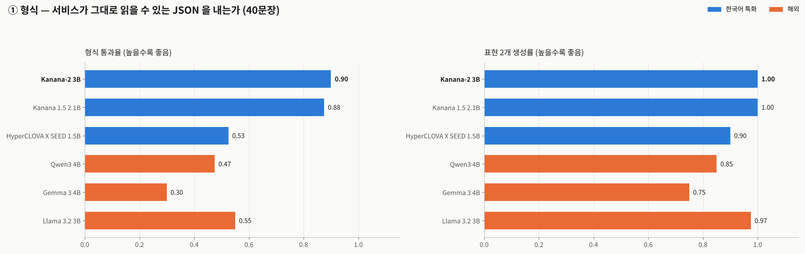
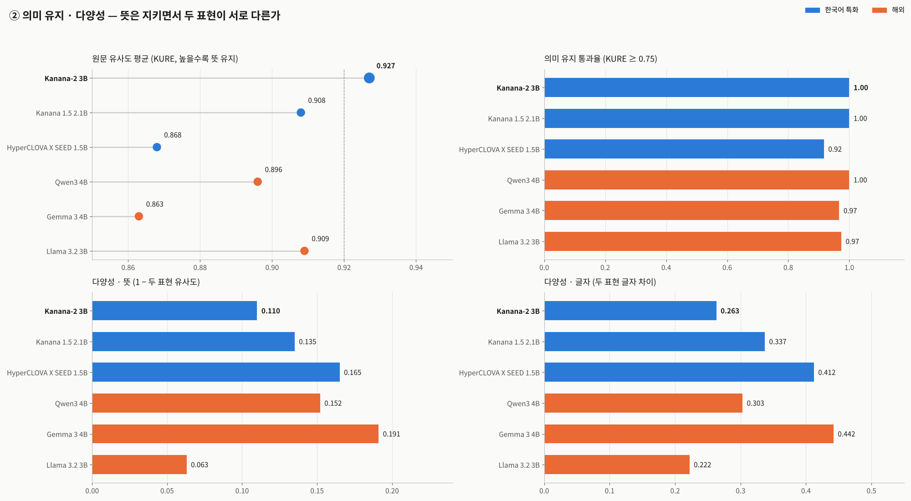
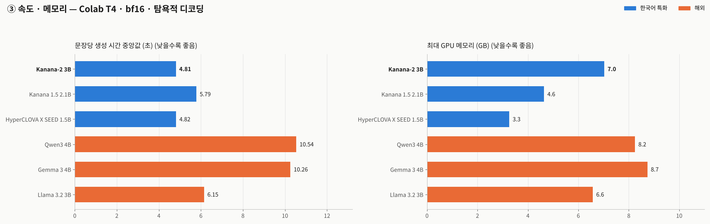
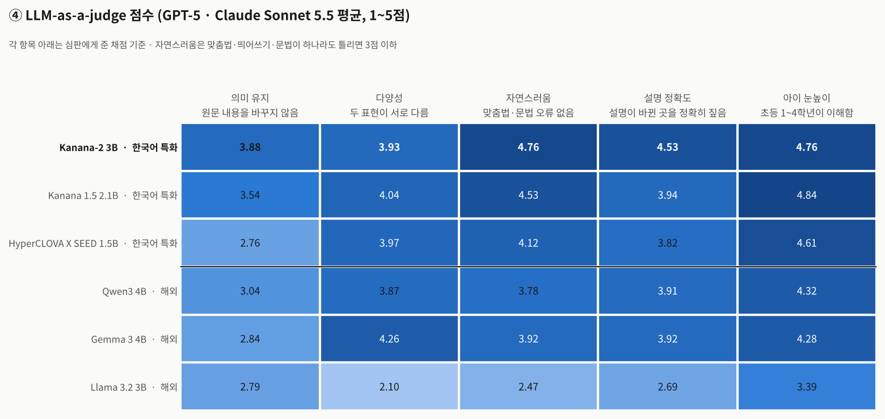

[← 전체 실험 요약으로](../README.md)

# 📖 동화모드

> 아이의 원문이 맞춤법에 맞더라도, 다양한 추가 표현을 생성하여 아이들의 **단어/표현 확장 학습**에 도움을 주고자 함.

<br>

## 1. 왜 LLM인가?

규칙 기반 시스템을 사용하기에는 한계가 있었고, **자연어 생성 LLM**을 쓰기로 결정함.

<br>

## 2. 상용 LLM API vs 오픈소스 sLLM

두 가지 경우를 크게 고려하였음.

1. 상용 LLM API 호출
2. 오픈소스 sLLM

### ❌ 1. 상용 LLM API 호출 → 제외

- **불안정성**
  제공사의 모델 업데이트/단종 등 이슈에 따라 동일한 프롬프트를 넣어도 응답 여부, 응답 품질, 스타일 등이 달라질 수 있어 불안정.
  아이들의 학습에 안정적이고 일정한 품질 및 말투를 제공해야 함을 고려할 때, 제외하기로 결정.
- **비용**
  또한 아이들의 눈높이에 맞춘, 원하는 결과를 얻고자 계속 프롬프트를 추가하는 과정에서, 그에 따른 호출 토큰 비용을 감당하기 어려울 수 있다고 판단.

### ✅ 2. 오픈소스 sLLM → 채택

- **충분한 성능**
  sLLM은 1에 비해 절대적인 성능 자체는 부족할 수 있으나, 우리 서비스가 문장 단위인 것을 고려해 낮은 파라미터의 모델로도 충분히 서비스를 제공 및 운영할 수 있을 것이라 판단.
- **비용 통제**
  추가로 자체 GPU 환경에서 운영할 수 있기 때문에 비용을 통제할 수 있음.

<br>

## 3. 최적의 오픈소스 sLLM은?

그렇다면 2. 오픈소스 sLLM 중에서도 최적의 모델은 무엇일까?

> **해외 IT 빅테크 개발 모델** vs **한국 IT 기업 개발 모델**

같은 조건(같은 문장 40개 · 같은 프롬프트 · 같은 지표 · 같은 심판)에서 **한국어 특화 3종**과 **해외 3종**을 비교함.
GPU 1장(Colab T4)에 올라가고 상업적 이용이 가능한 1.5B~4B 지시(instruct) 모델로 후보를 정함.

| 구분 | 모델 | Hugging Face ID | 크기 |
|---|---|---|---|
| 한국어 특화 | **Kanana-2 3B** (카카오) | `kakaocorp/kanana-2-3b-instruct` | 3B |
| 한국어 특화 | Kanana 1.5 2.1B (카카오) | `kakaocorp/kanana-1.5-2.1b-instruct-2505` | 2.1B |
| 한국어 특화 | HyperCLOVA X SEED 1.5B (네이버) | `naver-hyperclovax/HyperCLOVAX-SEED-Text-Instruct-1.5B` | 1.5B |
| 해외 | Qwen3 4B (알리바바) | `Qwen/Qwen3-4B-Instruct-2507` | 4B |
| 해외 | Gemma 3 4B (구글) | `google/gemma-3-4b-it` | 4B |
| 해외 | Llama 3.2 3B (메타) | `meta-llama/Llama-3.2-3B-Instruct` | 3B |

### 결론: **Kanana-2 3B 채택**

- **해외 모델은 형식부터 불안정함.** 형식 통과율이 0.30~0.55로, 절반 가까이는 서비스가 바로 읽을 수 없는 출력이었음.
  문장이 1개만 나오거나, 말투(…했다 / …했어요)가 바뀌거나, 한국어 문장 속에 영어·로마자가 섞임 (예: `잘 slept`, `meokbal`, `receaeseo`).
  생성 시간도 Qwen3·Gemma 3 는 문장당 약 10초로 한국어 특화 모델의 두 배 정도임.
- **한국어 특화 중에서는 Kanana 두 모델이 형식 통과율 0.88~0.90 으로 안정적**이었고, HyperCLOVA X SEED 는 0.53 에 그침.
- **Kanana-2 3B 를 고른 이유**: 형식 통과율(0.900)과 원문 유사도 평균(0.927)이 6개 모델 중 가장 높고 (원문 유사도 0.92 이상은 Kanana-2 3B 뿐),
  심판 점수도 **의미 유지 3.88 · 자연스러움 4.76 · 설명 정확도 4.53** 으로 모두 1위임. 문장당 생성 시간도 4.81초로 가장 짧음 (HyperCLOVA X SEED 4.82초와 비슷).
- **다양성은 조금 양보함.** 다양성 수치는 Kanana 1.5 2.1B 가 조금 높지만 (뜻 0.135 vs 0.110, 글자 0.337 vs 0.263), 심판 다양성 점수 차이는 작음 (4.04 vs 3.93).
  아이에게 보여 주는 표현과 설명이 **틀리지 않는 것**을 다양성보다 우선함.
- GPU 메모리는 7.0GB 로 T4(16GB) 한 장에 충분히 올라가고, **일기 모드의 설명문 생성에도 같은 모델을 써** 서버에 모델을 하나만 올리면 됨.

<br>

## 4. 평가 방식

> [!NOTE]
> 다만 최적의 모델 찾기에 쓰인 **LLM as judge**만 사양이 높은 상용 LLM을 API 방식으로 호출하여 성능평가하였음.

1. LLM as judge로 성능평가 (GPT-5, Claude Sonnet 5.5) --> 최적의 모델에 쓰이지 않은, 다른 계열의 모델을 판사로 임용하여, 판단의 정확성과 공정성을 높임.
2. 사람이 추가로 검토

<br>

## 5. 평가 결과

> 평가 문장은 아이 일기처럼 **직접 만든 합성 문장 40개**(…했다 32개 · …했어요 8개)이며, 실제 아이 글이나 외부 데이터셋은 쓰지 않음.

### 평가 지표

| 구분 | 지표 | 설명 |
|---|---|---|
| 형식 | 형식 통과율 | JSON 배열 · 표현 2개 · `text`/`point` 모두 있음 · 다른 글 없음 · 원문 말투 유지 · 한 문장 · 원문의 2배 이하 길이 · 원문/서로 베끼지 않음 — **모두** 통과한 비율 (보정 없이 엄격하게) |
| 의미 | 원문 유사도 평균 | 원문과 두 표현의 KURE-v1 임베딩 코사인 유사도 평균. 높을수록 원문의 뜻을 잘 지킴 |
| 의미 | 의미 유지 통과율 | 원문과 각 표현의 KURE-v1 임베딩 코사인 유사도가 **둘 다 0.75 이상**인 비율 |
| 다양성 | 다양성(뜻) | 1 − (표현 1 · 표현 2 의 KURE 유사도). 높을수록 두 표현의 뜻·구성이 다름 |
| 다양성 | 다양성(글자) | 1 − (표현 1 · 표현 2 의 글자 일치율, `difflib`). 높을수록 서로 다른 낱말을 씀 |
| 속도 | 문장당 시간 | 처음 2문장(준비 운동)을 뺀 중앙값 · p90 |
| 심판 | LLM-as-a-judge | GPT-5 · Claude Sonnet 5.5 가 의미 유지 · 다양성 · 자연스러움 · 설명 정확도 · 아이 눈높이를 1~5점으로 채점 (모델 이름은 가림) |
| 심판 | ㄴ 의미 유지 | 원문의 인물 · 행동 · 장소 · 사건을 바꾸거나 없는 일을 지어내지 않았는가 |
| 심판 | ㄴ 다양성 | 두 표현이 서로 다른 방법으로 바뀌었고, 원문을 거의 그대로 베끼지 않았는가 |
| 심판 | ㄴ 자연스러움 | 맞춤법 · 띄어쓰기 · 문법이 맞고 자연스러운 한국어인가 (틀린 곳이 하나라도 있으면 3점 이하) |
| 심판 | ㄴ 설명 정확도 | 표현마다 붙인 짧은 설명이 실제로 바뀐 부분을 정확히 가리키는가 |
| 심판 | ㄴ 아이 눈높이 | 초등 1~4학년이 이해할 낱말과 길이인가 |

### ① 형식


### ② 의미 유지 · 다양성


### ③ 속도 · 메모리


### ④ LLM-as-a-judge


### 전체 요약표

| 지표 | **Kanana-2 3B** | Kanana 1.5 2.1B | HCX SEED 1.5B | Qwen3 4B | Gemma 3 4B | Llama 3.2 3B |
|---|---|---|---|---|---|---|
| 형식 통과율 | **0.900** | 0.875 | 0.525 | 0.475 | 0.300 | 0.550 |
| 2개 생성률 | **1.000** | 1.000 | 0.900 | 0.850 | 0.750 | 0.975 |
| 원문 유사도 평균 | **0.927** | 0.908 | 0.868 | 0.896 | 0.863 | 0.909 |
| 의미 유지 통과율 | **1.000** | 1.000 | 0.917 | 1.000 | 0.967 | 0.974 |
| 다양성(뜻) | **0.110** | 0.135 | 0.165 | 0.152 | 0.191 | 0.063 |
| 다양성(글자) | **0.263** | 0.337 | 0.412 | 0.303 | 0.442 | 0.222 |
| 문장당 시간 중앙값(s) | **4.81** | 5.79 | 4.82 | 10.54 | 10.26 | 6.15 |
| 최대 GPU 메모리(GB) | **7.03** | 4.64 | 3.26 | 8.25 | 8.74 | 6.58 |
| 심판 의미 유지 | **3.88** | 3.54 | 2.76 | 3.04 | 2.84 | 2.79 |
| 심판 다양성 | **3.93** | 4.04 | 3.97 | 3.87 | 4.26 | 2.10 |
| 심판 자연스러움 | **4.76** | 4.53 | 4.12 | 3.78 | 3.92 | 2.47 |
| 심판 설명 정확도 | **4.53** | 3.94 | 3.82 | 3.91 | 3.92 | 2.69 |
| 심판 아이 눈높이 | **4.76** | 4.84 | 4.61 | 4.32 | 4.28 | 3.39 |

전체 수치(시간 p90 · 초당 토큰 · 로딩 시간 포함)는 [`results/summary_all.csv`](results/summary_all.csv).


## 6. 코드 파일

```
notebooks/
├── 1_story_ko.ipynb       # 한국어 특화 3종
└── 2_story_global.ipynb   # 해외 3종 (셀 1 의 모델 목록만 다름)
```


