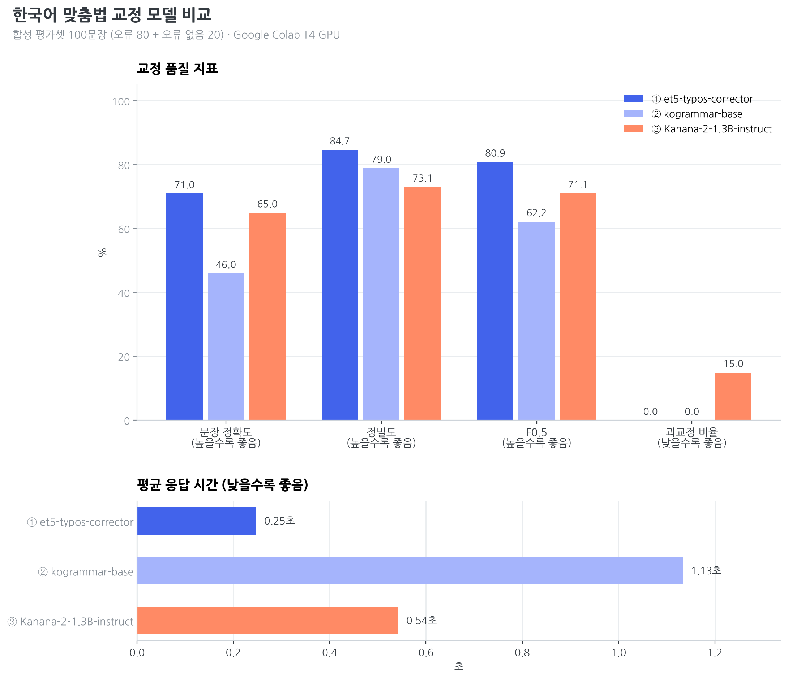
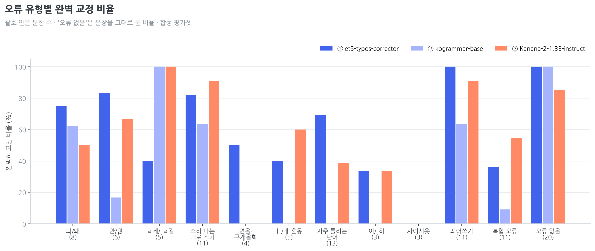

[← 전체 실험 요약으로](../README.md)

# 한국어 맞춤법 교정 모델 비교 실험

초등학생 글쓰기 교정 서비스에 쓸 **로컬 맞춤법 교정 모델**을 고르기 위한 실험이다.
아동 개인정보 보호를 위해 외부 API 없이 로컬에서 돌릴 수 있는 1.5B 이하 모델만 비교했다.

> ⚠️ 평가 데이터는 **100% 합성 데이터**다. 초등학생이 자주 틀리는 맞춤법 유형을 바탕으로 만든 예시 문장이며, 실제 아동의 글이나 개인정보는 포함되어 있지 않다.

## 결론

> **맞춤법 교정 모델로 ① j5ng/et5-typos-corrector 를 사용한다.**

정밀도·F0.5·과교정 모두 가장 좋고, 응답도 가장 빠르다.



## 비교 모델

| | 모델 | 구분 | 크기 | 라이선스 |
|---|---|---|---|---|
| ① | [j5ng/et5-typos-corrector](https://huggingface.co/j5ng/et5-typos-corrector) | 교정 전용 (ET5) | 경량 T5 | Apache-2.0 |
| ② | [theSOL1/kogrammar-base](https://huggingface.co/theSOL1/kogrammar-base) | 교정 전용 (KoBART) | 약 0.1B | MIT |
| ③ | [kakaocorp/kanana-2-1.3b-instruct](https://huggingface.co/kakaocorp/kanana-2-1.3b-instruct) | 범용 sLLM (프롬프트로 교정) | 1.3B | Kanana Open License |

세 모델 모두 파인튜닝 없이 공개된 그대로, 교정 결과 문장만 받아 비교했다.

## 평가 방법

- **데이터**: 합성 100문장 (오류 문장 80 + 오류 없는 문장 20), 오류 유형 11가지
- **비교 순서**: ① vs ② (교정 전용끼리) → 이긴 쪽 vs ③ (범용 sLLM)
- **지표**

| 지표 | 의미 |
|---|---|
| 문장 정확도 | 정답 교정문과 완전히 같은 문장 비율 |
| 정밀도 | 모델이 한 수정 중 맞은 수정 비율 (함부로 고치지 않는가) |
| **F0.5 (주 지표)** | 정밀도를 재현율보다 2배 중시한 종합 점수 |
| 과교정 비율 | 오류 없는 20문장 중 모델이 바꿔 버린 비율 (낮을수록 좋음) |

아이가 맞게 쓴 것을 틀렸다고 고치는 것이 틀린 것을 놓치는 것보다 학습에 더 해롭다고 보고, 정밀도 중심의 F0.5를 주 지표로 삼았다.

## 결과

실행 환경: Google Colab T4 GPU

| 모델 | 문장 정확도 | 정밀도 | F0.5 | 과교정 비율 | 재현율 | 평균 응답 |
|---|---|---|---|---|---|---|
| ① et5-typos-corrector | **71.0%** | **84.7%** | **80.9%** | **0.0%** | 68.5% | **0.25초** |
| ② kogrammar-base | 46.0% | 79.0% | 62.2% | **0.0%** | 33.7% | 1.13초 |
| ③ Kanana-2-1.3B-instruct | 65.0% | 73.1% | 71.1% | 15.0% | 64.0% | 0.54초 |

- **① vs ②**: 과교정은 둘 다 0%이고 나머지 지표는 모두 ①이 앞선다 (F0.5 +18.7%p, 속도 4배 이상).
- **① vs ③**: 재현율은 비슷하지만 ③은 오류 없는 문장 20개 중 3개를 바꿨고(과교정 15%), 정밀도도 약 12%p 낮다.

### 오류 유형별



- ①은 띄어쓰기(11/11), 안/않, 자주 틀리는 단어에서 강했다.
- ③은 ㅐ/ㅔ 혼동과 복합 오류에서 ①보다 나았다.
- 사이시옷(나뭇잎, 햇볕, 바닷가)은 세 모델 모두 하나도 고치지 못했다.

### 범용 sLLM(③)의 과교정 예

범용 sLLM은 맞춤법만 고치지 않고 **문장 자체를 다시 쓰는** 경우가 많았다.

| 입력 | ③ 출력 | 문제 |
|---|---|---|
| 우리 반이 이겨서 너무 기뻐서 소리를 질렀다. | 우리 반이 이겨서 너무 기뻤다. | 맞는 문장의 내용을 지움 |
| 오늘은 학교 끝나고 바로 집에 왔다. | …집에 왔습니다. | 말투를 바꿈 |
| 친구 가 나에게 사탕을 줬다. | 친구에게 사탕을 받았다. | 띄어쓰기 대신 문장을 새로 씀 |

아이 문장을 그대로 살려야 하는 서비스에서는 이런 다시 쓰기가 오류를 놓치는 것보다 더 큰 문제라고 판단했다.
범용 sLLM은 교정 대신 **근거 규정을 읽고 아이 눈높이로 설명하는 역할**에 쓰기로 했다.

## 한계

- 합성 데이터 100문장이라 실제 아동 글의 오류 분포와 다를 수 있고, 지표의 오차가 크다.
- 정답 교정문은 국립국어원 어문 규범 기준으로 작성했으나 교사 등 전문가 검수는 거치지 않았다.

## 재현 방법

```bash
pip install -r requirements.txt
python eval_correction.py --trust-remote-code   # 세 모델 실행 + 채점 → results/summary.csv, outputs.csv
```

## 구성

```
├── README.md
├── requirements.txt
├── eval_correction.py      세 모델 실행 + 4개 지표 채점
├── data/
│   └── synthetic_spelling_eval_100.jsonl   합성 평가셋 (id, 유형, 입력문장, 정답교정문, 수정내역)
└── figures/
    ├── metrics_comparison.png
    └── type_accuracy.png
```
